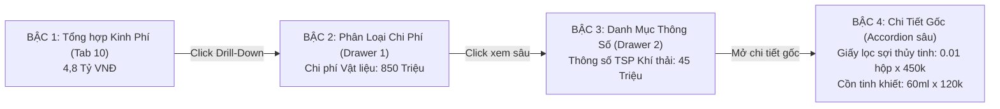
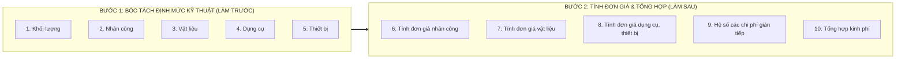

# 📋 KẾ HOẠCH DỰ ÁN: DuToanMoiTruongApp
**Hệ Thống Lập & Thẩm Định Dự Toán Quan Trắc Môi Trường EVN Vĩnh Tân 4**  
**Cơ sở pháp lý & Kỹ thuật:** Thông tư 20/2017/TT-BTNMT & Văn bản số 5691/EVN-MTPTBV ngày 06/10/2026 của EVN; Quyết định số 1155/QĐ-NĐVT4  
**Kiến trúc:** Layered Architecture & Single Source of Truth ("1 biến từ Cha đến Con")  

---

## 📌 I. CĂN CỨ PHÁP LÝ & ĐẶC TẢ NGHIỆP VỤ: VĂN BẢN SỐ 5691/EVN-MTPTBV & THÔNG TƯ 20
> **Văn bản số 5691/EVN-MTPTBV ngày 06/10/2026 của Tập đoàn Điện lực Việt Nam:**  
> Ban hành về việc tăng cường quản lý về công tác quan trắc, phân tích môi trường; quán triệt thực hiện Nghị quyết số 66.19/2026/NQ-CP ngày 18/5/2026 của Chính phủ. Tập đoàn chỉ đạo các đơn vị thành viên rà soát, cắt giảm, đơn giản hóa và chuẩn hóa toàn bộ khối lượng, định mức quan trắc môi trường theo đúng quy định tại Thông tư 20/2017/TT-BTNMT, chấm dứt triệt để việc lập dự toán trùng lặp khối lượng hoặc vượt định mức quy chuẩn Nhà nước.  
>  
> **Bản đặc tả phương án xác định đơn giá (đồng/mẫu):**  
> Chi tiết toàn diện tại [docs/PHUONG_AN_XAC_DINH_DON_GIA.md](docs/PHUONG_AN_XAC_DINH_DON_GIA.md) (Phân tầng cấu trúc 2 tầng: Chi phí Trực tiếp $T$ và Chi phí Gián tiếp $C_{GT}$; bóc tách rạch ròi giữa Nhóm yếu tố TRONG ĐỊNH MỨC TT20 và Nhóm yếu tố NGOÀI ĐỊNH MỨC/TÍNH RIÊNG theo Khoản 4.5 TT20).

---

## 💻 II. LÀM RÕ TECH STACK & KIẾN TRÚC PHẦN MỀM

### 1. Tech Stack Được Lựa Chọn (Tương thích hoàn hảo với ThamDinhDuToanApp & TaskApp_Tauri)
* **Backend & Data Calculation Engine**: 
  * **Python 3.9+**: Xử lý logic bóc tách 13 học phần TT20, thuật toán bóc tách định mức, kiểm thử tính toàn vẹn dữ liệu.
  * **Pydantic / Dataclasses**: Định nghĩa **Pure Data Schemas** chặt chẽ, kiểm soát định kiểu 100% (Type Safety), loại bỏ tình trạng undefined/NaN.
  * **openpyxl**: Engine sinh file Excel 10 Sheet động khép kín công thức (tương tự `LapDuToanApp`).
  * **FastAPI / Flask Micro-service**: API nhẹ chạy local phục vụ giao tiếp giữa Client và Engine.
* **Frontend Client & Reactive UI**:
  * **Vite + React 19 + TypeScript**: Biên dịch siêu tốc (< 1s), đảm bảo luồng dữ liệu 1 chiều *"Props Down, Events Up"*.
  * **Microsoft Fluent UI / TailwindCSS**: Giao diện chuẩn mực, hiện đại, đồng bộ phong cách với bộ ứng dụng của EVN.
  * **Virtual Scrolling & Smart Pagination**: Đảm bảo bảng dữ liệu hiển thị vừa vặn khung nhìn, không giật lag.
* **Storage & Persistence**:
  * **Atomic File IO (AtomicWriter)**: Chống corrupt file khi mất điện hoặc khi OneDrive đang sync dở dang.
  * **JSON Storage**: CSDL chuẩn hóa, phân tách rạch ròi với mã nguồn giao diện.

---

### 2. Cấu Trúc Thư Mục Dự Án

```
D:\TaskApp_kiet\DuToanMoiTruongApp/
├── .git/                                # Git Repository (nguyenhieuanhspkt@gmail.com)
├── .gitignore                           # Bỏ qua node_modules, cache, giữ lại src & docs
├── README.md                            # Hướng dẫn kiến trúc & vận hành
├── docs/                                # Hồ sơ kỹ thuật & Căn cứ pháp lý
│   ├── ARCHITECTURE.md                  # Tài liệu kiến trúc "1 biến từ Cha đến Con"
│   └── PHUONG_AN_XAC_DINH_DON_GIA.md   # Bản đặc tả phương án xác định đơn giá (đồng/mẫu)
├── backend/                             # TẦNG 1, 2: MODELS, STORAGE & SERVICES (Python)
│   ├── app.py                           # Local Service Entrypoint
│   ├── models/                          # Pure Data Schemas (pakt_item, norm_models, pricing_models)
│   ├── storage/                         # AtomicWriter & OneDriveAdapter
│   ├── services/                        # NormCalc, Pricing, Overhead, Summary Services
│   ├── exporters/                       # ExcelExporter (10 Sheet công thức sống)
│   └── tests/                           # Unit Tests kiểm tra chéo tính toàn vẹn
├── frontend/                            # TẦNG 3, 4: MASTER STATE & REACTIVE UI (React 19 + TS)
│   ├── package.json
│   ├── vite.config.ts
│   ├── src/
│   │   ├── main.tsx
│   │   ├── App.tsx                      # App Shell điều phối Header, Sidebar, Main, Footer
│   │   ├── state/                       # Master State Manager ("1 biến từ Cha đến Con")
│   │   ├── tabs/                        # 10 Projection Views (Khối lượng, Nhân công, VL, DC, TB...)
│   │   └── components/                  # HeaderNav, SidebarNav, FooterNav, Drawer đa tầng, KPI Cards
└── run_app.bat                          # Khởi chạy ứng dụng 1-Click
```

---

### 3. Phân Tách Lưu Trữ: Code Repo vs CSDL OneDrive

* **Mã nguồn (Source Code Repository):**  
  * Lưu tại: `D:\TaskApp_kiet\DuToanMoiTruongApp-` (chạy trên SSD, biên dịch Vite cực nhanh, không nghẽn OneDrive).
* **CSDL & Cache dự án (Data Storage & Cloud Cache):**  
  * Lưu tại: `D:\onedrive_hieuna\OneDrive - EVN\Tổ Thẩm định\Hiếu\2026_DuToanMoiTruongApp`  
  * Cấu trúc:
    ```
    2026_DuToanMoiTruongApp/
    ├── data/
    │   ├── pakt_253_items.json          # 253 dòng công việc Phụ lục 1 gốc
    │   ├── tt20_norm_database.json      # CSDL chuẩn hóa 13 học phần TT20 (6.42 MB, 742 thông số)
    │   ├── tt20_sections/               # Thư mục 13 file JSON học phần TT20
    │   ├── pricing_config.json          # Bảng đơn giá lương nhân công, vật tư, ca máy
    │   └── overhead_config.json         # Định mức % chi phí gián tiếp
    └── exports/                         # Nơi lưu file Excel/Word xuất bản
    ```

---

## 🖥️ III. QUY CHUẨN THIẾT KẾ GIAO DIỆN & TRẢI NGHIỆM NGƯỜI DÙNG (UI/UX SPECIFICATION)

Để đảm bảo hiệu năng tối ưu, tính khoa học của số liệu tài chính kỹ thuật và **loại bỏ triệt để tình trạng người dùng phải cuộn chuột lên xuống liên tục**, giao diện ứng dụng tuân thủ nghiêm ngặt mô hình **Application Shell Viewport-Fit**:

```
+---------------------------------------------------------------------------------------------------+
| [HEADER NAV] Logo EVN VT4 | Tên Dự Án | Đám Mây OneDrive Sync Status | Nút Xuất Excel | Fullscreen|
+-------------------+-------------------------------------------------------------------------------+
| [SIDEBAR NAV]     | [TOP TOOLBAR] Tìm kiếm nhanh (Ctrl+F) | Bộ lọc Đa cấp (Nhà máy, Môi trường)   |
|                   +-------------------------------------------------------------------------------+
| 📁 ĐỊNH MỨC KT    | [KPI CARDS] 📊 Tổng Mục: 253 | 👷 Tổng Công: 1.250 | 💰 Dự Toán: 4,8 Tỷ        |
|  1. Khối lượng    +-------------------------------------------------------------------------------+
|  2. Nhân công     | [MAIN DATA GRID - Cuộn nội vùng riêng / Sticky Table Header]                  |
|  3. Vật liệu      | STT | Mã CV | Tên Thông Số | Khối Lượng | Bậc Thợ | Định Mức | Thành Tiền      |
|  4. Dụng cụ       |  1  | 1KK4a | Bụi TSP      | 24 mẫu     | III.2   | 0.70     | ...  [Drill-in] |
|  5. Thiết bị      |  2  | 2KK4a | Phân tích TSP| 24 mẫu     | III.1   | 0.20     | ...  [Drill-in] |
|                   |  ... (vừa vặn khung nhìn màn hình, không trôi header)                        |
| 💰 ĐƠN GIÁ & PHÍ  +-------------------------------------------------------------------------------+
|  6. ĐG Nhân công  | [FOOTER NAV & SMART PAGINATION]                                               |
|  7. ĐG Vật liệu   | Trạng thái: Đồng bộ 100% | Số dòng/trang: [25 v] | << < [Trang 1 / 10] > >>    |
|  8. ĐG DC & TB    | Tổng: 253 mục | Hiển thị: 1 - 25 | Git: v0.1.0-baseline                       |
|  9. Phí gián tiếp +-------------------------------------------------------------------------------+
| 10. Tổng hợp KP   | Phím tắt: Alt+1..0: Chuyển Tab | Ctrl+F: Tìm | Esc: Đóng                      |
+-------------------+-------------------------------------------------------------------------------+
```

### 1. Phân Vùng Chức Năng Bố Cục (App Shell 4 Khu Vực Cố Định)
1. **Header Nav (Thanh điều hướng đỉnh - Chiều cao cố định `h-14` ~ 56px):**
   * Logo EVN Vĩnh Tân 4, huy hiệu trạng thái kết nối CSDL OneDrive (Đèn xanh: Đã kết nối / Đèn vàng: Đang sync).
   * Tên gói thầu thẩm định: *"Dự toán Quan trắc Môi trường 2026 - NMNĐ Vĩnh Tân 4 & Mở rộng"*.
   * Cụm công cụ hành động nhanh: Nút "Xuất Excel 10 Sheet", Nút "Làm mới dữ liệu", Nút chuyển đổi giao diện sáng/tối hoặc toàn màn hình.
2. **Sidebar Nav (Thanh điều hướng bên trái - Chiều rộng co giãn `w-64` / `w-16`):**
   * Bố trí danh mục 10 Tab được nhóm thành 2 khối trực quan:
     * *Khối 1 (Định mức Kỹ thuật):* Tabs 1 đến 5 (Icon chuyên ngành, badge số lượng mục).
     * *Khối 2 (Đơn giá & Tổng hợp Kinh phí):* Tabs 6 đến 10 (Icon tài chính, badge trạng thái hoàn tất).
   * **Collapsible (Thu gọn linh hoạt):** Có nút thu gọn Sidebar về dạng thanh icon nhỏ (`w-16`) khi người dùng cần mở rộng tối đa chiều ngang để soi bảng biểu nhiều cột.
3. **Main Content Area (Vùng làm việc chính - Tự động co giãn theo Viewport):**
   * **Top Toolbar & Multi-level Filter:** Thanh tìm kiếm tức thì theo từ khóa + Dropdown lọc đa cấp (Nhà máy VT4 / VT4 MR; Nhóm Định kỳ / Đối chứng; Môi trường Không khí / Khí thải / Nước...).
   * **KPI Summary Cards:** Hàng thẻ tóm tắt số liệu trọng yếu (Tổng số công việc, Tổng số công, Tổng kinh phí dự toán) hiển thị tức thì theo kết quả lọc.
   * **Sticky Data Grid:** Bảng dữ liệu có **tiêu đề cột luôn cố định (`sticky top-0`)**, khi cuộn xem số liệu không bao giờ bị trôi mất tên cột.
4. **Footer Nav & Smart Pagination (Thanh trạng thái & Phân trang đáy - Chiều cao `h-12` ~ 48px):**
   * Bên trái: Thông tin đồng bộ dữ liệu CSDL, mã commit Git hiện tại (`v0.1.0-baseline`).
   * Ở giữa: **Bộ điều khiển phân trang thông minh (Smart Pagination):**
     * Chọn nhanh số dòng hiển thị: `[15 dòng]`, `[25 dòng]`, `[50 dòng]`, `[100 dòng]`, hoặc `[Toàn bộ]`.
     * Bộ nút chuyển trang: Về đầu `<<`, Trang trước `<`, Ô nhập số trang trực tiếp, Trang sau `>`, Về cuối `>>`.
   * Bên phải: Thống kê hiển thị: *"Đang hiển thị mục 1 - 25 trong tổng số 253 mục"*.

---

### 2. Ý Nghĩa Triển Khai Thực Tế: Cơ Chế Truy Vết Ngược Xuôi & Drawer Đa Tầng



1. **Truy vết ngược xuôi (Traceability):**
   * Khi nhìn vào con số khổng lồ ở **Bậc 1 (Tổng hợp kinh phí toàn gói thầu)**, nếu Lãnh đạo hoặc đơn vị thắc mắc: *"Tại sao chi phí vật liệu đợt này cao thế?"*, người thẩm định chỉ cần bấm **Drill-Down** qua từng cấp độ để chỉ thẳng vào **Bậc 4**, nhìn thấy chính xác:
     * Tên loại hóa chất/vật liệu nào (ví dụ: Giấy lọc sợi thủy tinh, axit nitric tinh khiết, chuẩn khí NO/SO2).
     * Định mức tiêu hao là bao nhiêu cho 1 mẫu theo đúng Thông tư 20.
     * Nhân với số lượng mẫu và đơn giá nào dẫn đến con số đó.
   * Ngược lại, từ một chi tiết nhỏ ở Bậc 4 có thể truy vết xuôi xem nó đóng góp bao nhiêu % vào tổng dự toán toàn gói thầu.

2. **Thiết kế Giao diện Drawer Đa Tầng (Multi-level Slide-over):**
   * **Khi click ở Bậc 1 $\longrightarrow$ Mở Drawer cấp 2** trượt êm ái từ mép phải màn hình sang, hiển thị danh mục phân rã nhóm chi phí mà không làm mất trang tổng thể.
   * **Trong Drawer cấp 2, nếu muốn xem sâu hơn, click tiếp vào một dòng $\longrightarrow$ Drawer trượt sâu vào trong (hoặc mở rộng Accordion con)** để lột tả tiếp Bậc 3 (Thông số quan trắc) và Bậc 4 (Từng thành phần hao phí nhỏ nhất).
   * **Lợi ích tối thượng:** Giúp người thẩm định giữ nguyên vẹn được tư duy logic xuyên suốt, đối soát liên tục từ tổng quan đến chi tiết vi mô mà **không bị đứt đoạn ngữ cảnh (Context Preservation)**.

---

### 3. Định Dạng Cột Số Liệu Chuyên Biệt (Financial & Data-Dense Typography)
* **Font chữ đơn khoảng (Monospace digits / Tabular figures):**
  * Tất cả các cột số lượng, đơn giá, thành tiền, số công và hệ số chênh lệch ($\Delta$) bắt buộc sử dụng font chữ định dạng `font-mono` hoặc CSS `font-variant-numeric: tabular-nums`.
  * **Lợi ích:** Đảm bảo các con số có bề ngang bằng nhau 100%, thẳng hàng hoàn hảo theo hàng dọc từ hàng đơn vị, hàng chục đến hàng trăm, tránh hoàn toàn tình trạng số bị thụt thò khi quét mắt dò số liệu.
* **Tự động tô màu định dạng theo giá trị (Conditional Value Styling):**
  * **Số dương (Vượt định mức / Phát sinh):** Tự động hiển thị **Màu Đỏ (`text-red-600 bg-red-50`)** kèm tiền tố dấu `+` (ví dụ: `+12.50 công`, `+45.000.000 đ`).
  * **Số âm (Tiết kiệm / Cắt giảm hợp lý):** Tự động hiển thị **Màu Xanh Lá (`text-emerald-600 bg-emerald-50`)** kèm dấu `-` (ví dụ: `-8.20 công`, `-32.400.000 đ`).
  * **Số 0 (Khớp định mức):** Hiển thị màu trung tính mờ (`text-gray-400`).
  * **Lợi ích:** Tổ thẩm định phát hiện ngay lập tức các điểm bất thường và con số tiết kiệm mà không cần phải nhẩm tính thủ công.

---

### 4. Hệ Thống Phím Tắt Chuyên Nghiệp (Keyboard Shortcuts Master)
Hỗ trợ tối đa thao tác văn phòng liên tục, không phải rời tay khỏi bàn phím:
* `Ctrl + F`: Nhảy ngay tiêu điểm (focus) vào ô tìm kiếm nhanh thông số/mã công việc, tự động bôi đen văn bản cũ để gõ đè.
* `Alt + 1` đến `Alt + 0`: Chuyển nhanh tức thì giữa 10 Tab nghiệp vụ:
  * `Alt + 1`: Tab Khối lượng | `Alt + 2`: Tab Nhân công | `Alt + 3`: Tab Vật liệu | `Alt + 4`: Tab Dụng cụ | `Alt + 5`: Tab Thiết bị.
  * `Alt + 6`: Đơn giá NC | `Alt + 7`: Đơn giá VL | `Alt + 8`: Đơn giá DC, TB | `Alt + 9`: Phí gián tiếp | `Alt + 0`: Tổng hợp kinh phí.
* `Ctrl + S`: Lưu thủ công cấu hình, ghi chú thẩm định hoặc trạng thái hiện tại vào CSDL OneDrive.
* `Esc`: Đóng nhanh các cửa sổ Modal/Popup, Drawer chi tiết bóc tách hoặc xóa trắng bộ lọc tìm kiếm hiện tại.
* **Lợi ích:** Tăng tốc độ thao tác thẩm định hồ sơ lên gấp 3–5 lần so với việc dùng chuột thuần túy.

---

### 5. Trạng Thái Trống & Gợi Ý Thao Tác (Empty States & Guidance)
* Khi người dùng nhập từ khóa tìm kiếm hoặc chọn bộ lọc mà không có thông số nào khớp trong bảng 253 dòng:
  * **Tuyệt đối không để màn hình trắng trơn hay báo lỗi:** Giao diện hiển thị một thẻ Empty State tinh tế gồm biểu tượng kính lúp, thông báo rõ ràng:  
    *“Không tìm thấy thông số phù hợp với từ khóa **'XYZ'** trong phân hệ hiện tại.”*
  * **Kèm theo nút hành động trực tiếp:** Nút bấm **[Xóa bộ lọc & Xem toàn bộ]** (`Clear Filter`) giúp người dùng quay lại trạng thái đầy đủ chỉ với 1 cú click.
* **Lợi ích:** Giữ cho giao diện luôn có tính hướng dẫn rõ ràng, thân thiện, không gây hoang mang cho người dùng trong quá trình lọc dữ liệu phức tạp.

---

### 6. Nguyên Tắc "Không Cần Cuộn Lên Xuống Nhiều" (Zero Unnecessary Scrolling)
* **Kỹ thuật Viewport-Fit (`h-screen overflow-hidden flex flex-col`):**
  * Toàn bộ ứng dụng khóa chặt vừa khít trong đúng 1 màn hình máy tính (không xuất hiện thanh cuộn bao ngoài toàn trang).
  * Header, Sidebar, Toolbar lọc và Footer luôn đứng yên trong tầm mắt.
* **Cuộn nội vùng độc lập (Internal Scroll Container):**
  * Chỉ duy nhất phần thân bảng dữ liệu (`<tbody>`) có thanh cuộn riêng khi số lượng dòng vượt quá chiều cao trang hiển thị.
* **Phân trang mặc định tối ưu:** Thiết lập mặc định hiển thị 20–25 dòng/trang, giúp trọn vẹn bảng nằm gọn trong tầm mắt của màn hình laptop văn phòng (1366x768 hoặc 1920x1080) mà hoàn toàn không cần cuộn chuột.

---

## 📑 IV. CẤU TRÚC 10 TAB CHUẨN MỰC CỦA HỆ THỐNG



1. **Tab 1: Khối lượng** — 253 dòng công việc Phụ lục 1 PAKT, đối chiếu mã gộp TT20.
2. **Tab 2: Nhân công** — Bóc tách chi tiết định mức ngày công theo từng ngạch bậc QTVTNMT (hạng II, III.1, III.2, IV).
3. **Tab 3: Vật liệu** — Bóc tách định mức hóa chất, thuốc thử, dung môi, giấy lọc...
4. **Tab 4: Dụng cụ** — Bóc tách định mức dụng cụ lấy mẫu hiện trường, bảo hộ lao động...
5. **Tab 5: Thiết bị** — Bóc tách ca máy quan trắc, máy đo quang phổ, tủ sấy, cân phân tích, điện năng...
6. **Tab 6: Tính đơn giá nhân công** — Bảng tính đơn giá lương ngày công các bậc thợ theo hướng dẫn EVN.
7. **Tab 7: Tính đơn giá vật liệu** — Bảng tổng hợp báo giá/hóa đơn vật liệu, hóa chất thí nghiệm.
8. **Tab 8: Tính đơn giá dụng cụ, thiết bị** — Bảng tính chi phí khấu hao ca máy và dụng cụ.
9. **Tab 9: Hệ số các chi phí gián tiếp** — Định mức Chi phí quản lý chung, Chi phí phụ trợ, Chi phí dự phòng.
10. **Tab 10: Tổng hợp kinh phí** — Bảng tổng hợp dự toán trần hoàn chỉnh toàn gói thầu quan trắc môi trường 2026.

---

## 📅 V. LỘ TRÌNH TRIỂN KHAI CHI TIẾT

### Giai đoạn 0: Thiết lập Nền tảng, Khung App & Ban hành Bản Đặc tả Đơn giá (ĐÃ HOÀN THÀNH - Baseline v0.1.0)
* **Đường dẫn Repository:** `D:\TaskApp_kiet\DuToanMoiTruongApp-`
* **CSDL & Cache dự án:** `D:\onedrive_hieuna\OneDrive - EVN\Tổ Thẩm định\Hiếu\2026_DuToanMoiTruongApp`
* **Git Author:** Name: `Anh Hieu` | Email: `nguyenhieuanhspkt@gmail.com`
* **Nhiệm vụ & Kết quả nghiệm thu:**
  - [x] **Bước 0.1**: Tạo thư mục repo tại `D:\TaskApp_kiet\DuToanMoiTruongApp-`, cấu hình git (`user.name`, `user.email`).
  - [x] **Bước 0.2**: Thiết lập thư mục CSDL OneDrive tại `...\data`, tích hợp 253 dòng PAKT gốc (`pakt_253_items.json`), 13 tệp JSON học phần `tt20_sections/`, và CSDL chuẩn hóa toàn diện `tt20_norm_database.json` (6.42 MB, 742 thông số, 13 học phần).
  - [x] **Bước 0.3**: Xây dựng khung **Backend Python FastAPI** (Models Pure Data Pydantic v2, Storage kết nối OneDrive, In-memory Caching, bộ API tra cứu `/api/tt20/*`, test tính toàn vẹn đạt 100%).
  - [x] **Bước 0.4**: Xây dựng khung **Frontend React 19 + TypeScript + Vite**:
    * Thiết lập đúng quy chuẩn UI App Shell: Header cố định, Sidebar thu gọn, Smart Pagination, Drawer đa tầng, không cuộn thừa.
    * Tích hợp Tabular Numbers, Phím tắt (`Ctrl+F`, `Alt+1..0`, `Esc`), Empty State trực quan.
    * Quản lý Master State ("1 biến từ Cha đến Con").
    * Xây dựng **Tab 1: Khối lượng** và **Tab 2: Nhân công**.
  - [x] **Bước 0.5 (MỐC COMMIT BASELINE v0.1.0 & BAN HÀNH ĐẶC TẢ ĐƠN GIÁ)**:
    * Commit Git Baseline v0.1.0 (`843ff22`) và CSDL đồng bộ (`af78b47`).
    * Ban hành Bản đặc tả nghiệp vụ & Phương án xác định đơn giá chuẩn 2 tầng tại [docs/PHUONG_AN_XAC_DINH_DON_GIA.md](docs/PHUONG_AN_XAC_DINH_DON_GIA.md) (Commit `e20a6bb`, `82b23f8`).

---

### Giai đoạn 1: Hoàn thiện 3 Tab Định Mức Kỹ Thuật (Vật Liệu, Dụng Cụ, Thiết Bị)
* **Nhiệm vụ & Quy chuẩn kỹ thuật áp dụng:**
  - [ ] **Tab 3: Định mức Vật liệu & Hóa chất**:
    * Trích xuất tự động danh mục định mức hóa chất, giấy lọc từ `tt20_norm_database.json`.
    * Tự động tính toán hệ số **+8% vật liệu vụn vặt và hao hụt** ($k_{\text{hh}} = 0{,}08$) theo Khoản 4.4 TT20:
      $$D_{VL\_tổng} = \sum (D_{VL\_TT20}) \times (1 + k_{\text{hh}}), \quad k_{\text{hh}} = 0{,}08$$
    * Bảng ma trận tổng hợp nhu cầu vật liệu/hóa chất toàn gói thầu theo $N$ mẫu.
  - [ ] **Tab 4: Định mức Dụng cụ**:
    * Trích xuất danh mục dụng cụ đo, bình lấy mẫu, đồ bảo hộ lao động từ CSDL TT20.
    * Quy đổi niên hạn sử dụng theo số ca chuẩn ($22$ ca/tháng: $S_{\text{ca}} = T_m \times 22$).
    * Tự động cộng thêm **+10% dụng cụ nhỏ, phụ** ($k_{\text{dc\_phụ}} = 0{,}10$) theo Khoản 4.2 TT20:
      $$D_{DC\_tổng} = \sum \left( \frac{1}{T_m \times 22} \right) \times (1 + k_{\text{dc\_phụ}}), \quad k_{\text{dc\_phụ}} = 0{,}10$$
  - [ ] **Tab 5: Định mức Thiết bị & Ca máy**:
    * Phân loại số ca máy chuẩn hàng năm theo Khoản 4.3 TT20:
      - Ngoại nghiệp đất liền: $250$ ca/năm.
      - Ngoại nghiệp vùng biển xa (Học phần II.6): $200$ ca/năm.
      - Nội nghiệp phòng thí nghiệm: $500$ ca/năm.
    * Cơ chế kế thừa thiết bị: Đối với các chỉ tiêu đo đồng thời trên cùng máy đa chỉ tiêu, thông số phụ kế thừa có định mức ca máy $= 0$ để triệt tiêu việc tính trùng ca máy.
    * Tính toán suất điện năng tiêu thụ ($kWh$) theo công suất máy phòng lab.
  - [ ] Chạy Unit Test kiểm tra chéo: Đảm bảo dữ liệu 5 Tab định mức khớp 100% với CSDL TT20.
  - [ ] **Commit Git:** `feat: complete technical norm breakdown tabs 3, 4, 5 with statutory factors`.

---

### Giai đoạn 2: Xây dựng Bộ Tính Đơn Giá & Chi Phí Gián Tiếp (Tabs 6, 7, 8, 9)
* **Nhiệm vụ & Quy chuẩn tài chính áp dụng:**
  - [ ] **Tab 6: Đơn giá Nhân công**:
    * Áp dụng định mức ngày công TT20 nhân với đơn giá ngày công theo thang lương chuyên gia/kỹ sư môi trường.
    * Ngoại nghiệp nhân hệ số thời tiết $+20\%$ ($k_{\text{tt}} = 0{,}2$ theo Khoản 4.1.3 TT20).
    * Phân bổ công lấy mẫu dùng chung: $C_{NC\_field\_per\_test} = C_{NC\_field} / M$ ($M \ge 1$).
  - [ ] **Tab 7: Đơn giá Vật liệu**:
    * Nạp bảng giá thị trường từ 3 báo giá cạnh tranh hoặc kết quả trúng thầu gần nhất (theo Luật Đấu thầu và NĐ 24/2024/NĐ-CP).
  - [ ] **Tab 8: Đơn giá Dụng cụ & Ca máy**:
    * Tính đơn giá ca máy khấu hao theo Thông tư 45/2013/TT-BTC chia cho số ca chuẩn $250 / 200 / 500$ ca:
      $$ĐG_{\text{ca}} = \frac{\text{Nguyên giá} \times (T_{\text{khấu hao}} + T_{\text{bảo dưỡng}})}{S_{\text{ca\_năm}}} + ĐG_{\text{năng lượng}} + ĐG_{\text{thay thế}}$$
  - [ ] **Tab 9: Chi phí Gián tiếp & Phân hệ Chi phí Ngoài Định Mức (Tính riêng)**:
    * Quản lý các hệ số gián tiếp: Chi phí chung ($k_{\text{c}} = 15\%$), Thu nhập chịu thuế tính trước ($TL = 6\%$), Dự phòng phí ($k_{\text{dp}} = 5\%$), Thuế VAT ($8\%$ hoặc $10\%$).
    * **Phân hệ Chi phí Ngoài định mức tính riêng (Khoản 4.5 TT20)**:
      - Chi phí đi lại, lưu trú chuyên gia: Theo Thông tư 40/2017/TT-BTC.
      - Chi phí giàn giáo phục vụ đo khí thải ống khói cao: Áp dụng định mức Bộ Xây dựng (TT 12/2021/TT-BXD).
      - Chi phí thuê tàu biển đo đạc xa bờ Vĩnh Tân: 3 báo giá tàu dịch vụ biển địa phương.
      - Chi phí vận chuyển mẫu lạnh hỏa tốc về PTN: Hợp đồng chuyển phát nhanh chuyên dụng.
  - [ ] **Commit Git:** `feat: integrate unit pricing and indirect cost calculation (tabs 6-9)`.

---

### Giai đoạn 3: Dashboard Tab 10 & Xuất Excel 10 Sheet Động Khép Kín Công Thức
* **Nhiệm vụ & Sản phẩm bàn giao:**
  - [ ] **Tab 10: Dashboard Tổng hợp So sánh Đa kịch bản (PAKT)**:
    * **Phương án 1 (Chuẩn định mức TT20)**: Tính chi tiết từ 9 Tab theo định mức kinh tế kỹ thuật.
    * **Phương án 2 (Báo giá thị trường Điều 16 NĐ 24/2024/NĐ-CP)**: Tổng hợp từ 3 báo giá trọn gói của các đơn vị quan trắc có Vimcerts.
    * **Phương án 3 (Kế thừa lịch sử)**: Dựa trên đơn giá Hợp đồng số 71/2025/HĐ-DV có tính trượt giá CPI.
    * Bảng so sánh trực quan chênh lệch kinh phí giữa 3 phương án để Tổ thẩm định ra quyết định phê duyệt trần dự toán.
  - [ ] **Engine Xuất Bản Báo Cáo Thẩm Định & File Excel 10 Sheet (OpenPyXL)**:
    * Tự động sinh tệp Excel thẩm định 10 sheet giữ nguyên công thức sống giữa các sheet kế thừa từ mẫu biểu `01_Excel_Dinh_Muc_6_Bang`.
    * Xuất file Word/PDF Báo cáo thẩm định kinh phí tự động theo mẫu biểu quản lý nội bộ.
  - [ ] **Commit Git:** `feat: complete executive summary dashboard (tab 10) & 10-sheet dynamic excel exporter`.
