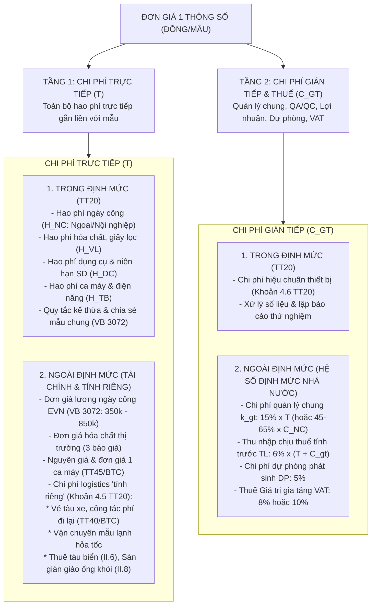

# 📋 BẢN ĐẶC TẢ NGHIỆP VỤ & PHƯƠNG ÁN XÁC ĐỊNH ĐƠN GIÁ
## QUAN TRẮC MÔI TRƯỜNG ĐƠN VỊ TÍNH (ĐỒNG / MẪU)
**Căn cứ pháp lý & Kỹ thuật:**  
- Thông tư số 20/2017/TT-BTNMT ngày 08/8/2017 của Bộ Tài nguyên và Môi trường.
- Văn bản số 3072/EVN-MTPTBV ngày 31/5/2026 của Tập đoàn Điện lực Việt Nam.
- Nghị quyết số 66.19/2026/NQ-CP ngày 18/5/2026 của Chính phủ.

---

## 📌 I. KẾT LUẬN TỔNG QUAN (EXECUTIVE SUMMARY)

1. **Cấu trúc 2 Tầng vĩ mô của Đơn giá quan trắc môi trường (Đồng/mẫu):**  
   Mọi đơn giá thông số quan trắc đều được cấu thành từ 2 tầng chi phí gốc rễ, trong đó mỗi tầng được phân định rạch ròi giữa **Nhóm yếu tố TRONG ĐỊNH MỨC (Kỹ thuật TT20)** và **Nhóm yếu tố NGOÀI ĐỊNH MỨC (Tài chính, Chế độ Nhà nước, VB 3072 và Chi phí tính riêng)**:

$$\mathbf{P_{\text{(Đồng/mẫu)}}} = \underbrace{\mathbf{T_{\text{Trực tiếp}}}}_{\substack{\text{Nhân công, Hóa chất,} \\ \text{Dụng cụ, Thiết bị, Logistics}}} + \underbrace{\mathbf{C_{\text{Gián tiếp}}}}_{\substack{\text{Chi phí chung, Thu nhập tính trước,} \\ \text{Dự phòng, Thuế VAT}}}$$

2. **Bản chất của đơn vị tính "Đồng / Mẫu" (VNĐ/sample):**
   - **"Mẫu" (Sample) trong quy chuẩn TT20:** Là **01 đơn vị mẫu đại diện vật lý** (1 can nước, 1 bình khí, 1 phin lọc bụi, 1 khối trầm tích) hoặc **01 lần đo/phép thử trực tiếp tại hiện trường** (In-situ test) được thực hiện theo đúng tiêu chuẩn kỹ thuật quy định.
   - **Đơn vị tính "Đồng/mẫu":** Là toàn bộ chi phí tài chính hợp lý, hợp lệ cần thiết để hoàn thành **chu trình trọn gói cho mẫu đó**: từ chuẩn bị vật tư, lấy mẫu hiện trường, bảo quản, vận chuyển, phân tích tại phòng lab đến khi ban hành Phiếu kết quả thử nghiệm đạt chuẩn QA/QC.

---

## 🏛️ II. SƠ ĐỒ PHÂN TẦNG VĨ MÔ: CHI PHÍ TRỰC TIẾP & CHI PHÍ GIÁN TIẾP

---

## 🔍 III. CHI TIẾT TẦNG 1: NHÓM YẾU TỐ QUYẾT ĐỊNH CHI PHÍ TRỰC TIẾP ($T$)

### 1. Phân hệ TRONG ĐỊNH MỨC (Inside Norm - Thông tư 20/2017/TT-BTNMT)
Quy định mức tiêu hao vật lý, cơ học và thời gian lao động bắt buộc cho 1 mẫu:

#### A. Hao phí Nhân công ($H_{NC}$):
- **Cơ cấu định biên bậc thợ:** Phân định rõ 5 ngạch bậc theo từng thông số: QTVTNMT hạng II, III.1, III.2, IV, và Lao động phổ thông.
- **Phân đoạn công đoạn kỹ thuật:**
  - *Đo nhanh tại chỗ (Single/In-situ):* Chỉ có 1 mã duy nhất, công nội nghiệp = 0 (ví dụ `KKC2a` đo ồn, `1KT9c` đo NO, `1KT9d` đo $NO_2$).
  - *Ghép cặp chuẩn (Paired: `1...` + `2...`):* 1 công đoạn lấy mẫu ngoại nghiệp + 1 công đoạn phân tích nội nghiệp phòng lab.
  - *Đặc thù 3 Tiền tố Nước biển (Học phần II.6):* Phân hóa điều kiện lấy mẫu: **`1NB` (Ven bờ)** vs **`2NB` (Xa bờ - đi tàu biển lớn, số công cao hơn 20-50%)** ghép cặp với **`3NB` (Nội nghiệp phòng lab)**.
- **Quy tắc chia sẻ mẫu chung & Chống trùng lặp theo VB 3072/EVN:**
  - Khi 1 can nước/1 phin lọc phân tích $M$ chỉ tiêu, số ngày công lấy mẫu ngoại nghiệp của từng chỉ tiêu phải được chia đều cho $M$ ($\frac{H_{NC\_field}}{M}$), không được nhân kép làm đội dự toán!

#### B. Hao phí Vật liệu, Hóa chất ($H_{VL}$):
- Bảng *Hao_Phi_Vat_Lieu*: Khối lượng/thể tích axit tinh khiết, dung môi chiết, chất chuẩn đối chứng, giấy lọc sợi thủy tinh, túi Tedlar, chuẩn khí quy định cho 1 mẫu.

#### C. Hao phí Dụng cụ & Bảo hộ lao động ($H_{DC}$):
- Bảng *Hao_Phi_Dung_Cu*: Định lượng dụng cụ đo, bình chứa, hộp petri, quần áo BHLĐ.
- **Niên hạn sử dụng (tháng):** TT20 quy định niên hạn chuẩn (từ 3 đến 36 tháng) để phân bổ hao mòn cho 1 ca làm việc.

#### D. Hao phí Thiết bị máy móc & Điện năng ($H_{TB}$):
- Bảng *Hao_Phi_Thiet_Bi*: Định mức số ca máy/giờ máy (máy đo khí đa chỉ tiêu, máy lấy mẫu bụi Isokinetic, quang phổ UV-VIS, sắc ký GC/MS, tủ sấy, cân 4 số).
- **Suất tiêu hao điện năng ($kWh$):** Năng lượng điện vận hành thiết bị PTN.
- **Quy tắc Kế thừa thiết bị:** Nếu thông số phụ có ghi chú *"Kế thừa từ mục XYZ"*, thì định mức thiết bị của thông số phụ = 0.

---

### 2. Phân hệ NGOÀI ĐỊNH MỨC (Outside Norm - Tài chính, Thị trường & Chi phí tính riêng)

#### A. Đơn giá Tài chính Tiền lương & Vật tư:
1. **Khung đơn giá lương ngày công EVN (Văn bản số 3072/EVN-MTPTBV ngày 31/5/2026):**
   - QTVTNMT hạng II: **850.000 VNĐ/công**
   - QTVTNMT hạng III.1: **650.000 VNĐ/công**
   - QTVTNMT hạng III.2: **550.000 VNĐ/công**
   - QTVTNMT hạng IV: **450.000 VNĐ/công**
   - Kỹ thuật viên / Lao động phổ thông: **350.000 VNĐ/công**
2. **Đơn giá Hóa chất & Vật liệu:** Xác định theo hóa đơn thực tế hoặc mức giá tối thiểu của **3 bảng báo giá cạnh tranh** từ nhà cung cấp hóa chất đạt chuẩn.
3. **Đơn giá 1 ca máy ($G_{\text{ca máy}}$):** Tính toán theo Thông tư 45/2013/TT-BTC:
   $$G_{\text{ca máy}} = \frac{\text{Nguyên giá máy} \times \text{Tỷ lệ khấu hao năm} + \text{Chi phí bảo dưỡng} + \text{Kiểm định/hiệu chuẩn}}{250 \text{ ca/năm}}$$
4. **Đơn giá Điện năng:** Áp dụng theo biểu giá bán lẻ điện sản xuất giờ bình thường của EVN.

#### B. Các khoản Chi phí Trực tiếp "TÍNH RIÊNG" (Khoản 4.5 TT20):
Thông tư 20 khẳng định dứt khoát: Định mức chỉ tính cho thao tác tại chỗ, các chi phí sau phải **tính riêng theo từng Thiết kế kỹ thuật - Dự toán**:
1. **Chi phí đi lại & lưu trú nhân lực (Logistics con người):** Vé máy bay, vé tàu xe đưa đón từ trụ sở tư vấn đến Vĩnh Tân và phụ cấp công tác phí hiện trường (theo Thông tư 40/2017/TT-BTC).
2. **Chi phí vận chuyển mẫu lạnh hỏa tốc:** Cước chuyển phát nhanh mẫu nước/bùn bảo quản $4^\circ\text{C}$ bằng đá gel/đá khô về PTN trong vòng 24h.
3. **Chi phí thuê phương tiện thủy chuyên dụng (Học phần II.6):** Thuê tàu biển lớn, ca-nô lấy mẫu nước biển ven bờ và xa bờ Vĩnh Tân.
4. **Chi phí sàn thao tác & lỗ lấy mẫu khí thải (Học phần II.8):** Chi phí dựng giàn giáo trèo cao 30m - 100m, gia công lỗ lấy mẫu theo US-EPA Method 1, kéo nguồn điện tạm phục vụ máy đo khí.

---

## 📊 IV. CHI TIẾT TẦNG 2: NHÓM YẾU TỐ QUYẾT ĐỊNH CHI PHÍ GIÁN TIẾP ($C_{GT}$) & THUẾ

### 1. Phân hệ TRONG ĐỊNH MỨC (Inside Norm - Thông tư 20/2017/TT-BTNMT)
- **Chi phí hiệu chuẩn thiết bị (Calibration):** Khoản 4.6 TT20 quy định dứt khoát *"Hiệu chuẩn thiết bị được tính toán chung trong chi phí quản lý chung cấu thành trong Đơn giá"*, nghiêm cấm nhà thầu lập riêng thành mục chi phí con!
- **Hao phí tổng hợp và xử lý số liệu:** Công tác đối chiếu quy chuẩn QCVN, vẽ biểu đồ và lập Báo cáo thử nghiệm đạt chuẩn ISO/IEC 17025 (Vimcerts) đã được tích hợp trong tỷ lệ chi phí chung.

### 2. Phân hệ NGOÀI ĐỊNH MỨC (Outside Norm - Định mức tỷ lệ Nhà nước & EVN)
1. **Chi phí Quản lý chung ($k_{GT}$):**  
   Thường áp dụng **$k_{GT} = 15\%$ tính trên Chi phí trực tiếp ($T$)** (hoặc $45\% - 65\%$ tính trên Chi phí nhân công $C_{NC}$), chi trả cho bộ máy điều hành, văn phòng, an toàn vệ sinh lao động.
2. **Thu nhập chịu thuế tính trước ($TL$):**  
   Lợi nhuận định mức cho đơn vị thực hiện quan trắc: **$TL = 6\% \times (T + C_{GT})$**.
3. **Chi phí Dự phòng phát sinh ($DP$):**  
   Dự phòng yếu tố trượt giá và khối lượng phát sinh đột xuất: **$DP = 5\% \times (T + C_{GT} + TL)$**.
4. **Thuế Giá trị gia tăng (VAT):**  
   Áp dụng thuế suất thuế GTGT theo luật định (hiện hành là 8% hoặc 10%).

---

## 📐 V. BẢN ĐỒ CÔNG THỨC TOÁN HỌC XÁC ĐỊNH ĐƠN GIÁ (ĐỒNG/MẪU)

$$\mathbf{P_{\text{(Đồng/mẫu)}}} = \underbrace{\Bigg[ \left( \frac{H_{NC\_field} \times L_{\text{bậc}}}{M_{\text{dùng chung}}} + H_{NC\_lab} \times L_{\text{bậc}} \right) + C_{VL} + C_{DC} + C_{TB} + C_{\text{tính riêng}} \Bigg]}_{\mathbf{\text{TỔNG CHI PHÍ TRỰC TIẾP } (T)}} \times \mathbf{\Phi_{\text{gián tiếp & thuế}}}$$

Trong đó, hệ số tích hợp gián tiếp và thuế:
$$\mathbf{\Phi_{\text{gián tiếp & thuế}}} = (1 + k_{GT}) \times (1 + TL) \times (1 + DP) \times (1 + \text{VAT})$$

- Với $k_{GT} = 15\%$, $TL = 6\%$, $DP = 5\%$, $\text{VAT} = 8\%$:
  $$\mathbf{\Phi_{\text{gián tiếp & thuế}}} = 1,15 \times 1,06 \times 1,05 \times 1,08 \approx \mathbf{1,3823} \quad (+38,23\%)$$

---

## 🛠️ VI. BẢNG MA TRẬN ĐỐI CHIẾU THỰC HÀNH CHO TỔ THẨM ĐỊNH EVN VĨNH TÂN 4

| Nhóm thông số điển hình | Cấu trúc Mã TT20 | Chi phí Trực tiếp Trong ĐM (TT20) | Chi phí Trực tiếp Ngoài ĐM & Tính riêng | Chi phí Gián tiếp & Thuế | Lưu ý cốt tử khi Thẩm định (VB 3072) |
| :--- | :---: | :--- | :--- | :--- | :--- |
| **Bụi TSP ống khói lò hơi VT4** | `1KT10a` + `2KT10a` | - Lấy mẫu Isokinetic: 4,0 công - Cân phân tích lab: 0,8 công - Phin lọc sợi thủy tinh chịu nhiệt | - Lương bậc III.4 (450k) - Giàn giáo sàn thao tác trèo cao 60m (tính riêng) - Khấu hao máy đo lưu lượng | $+38,23\%$ (Chi phí chung + Lợi nhuận + Dự phòng + VAT) | Bắt buộc phải có hạng mục sàn thao tác tính riêng; kiểm tra đúng phương pháp US-EPA Method 5. |
| **Khí NO, NO2 đo trực tiếp ống khói** | `1KT9c`, `1KT9d` | - Đo sensor tại chỗ: 0,75 công/khí - Không có mã nội nghiệp (`2...`) - Không tốn hóa chất | - Lương bậc III.3 (550k) - Khấu hao máy đo khí Flue Gas Analyzer | $+38,23\%$ | **CẤM tính thêm mã nội nghiệp `2KT9b`** vì đã đo trực tiếp bằng sensor; không tính trùng phương pháp. |
| **Khí tổng NOx hóa học ống khói** | `1KT9e` + `2KT9b` | - Hấp thụ Method 7: 0,70 công - So màu lab: 0,80 công - Hóa chất H2SO4, H2O2, PDA | - Lương bậc III.2, III.3 - Khấu hao máy quang phổ UV-VIS | $+38,23\%$ | Chỉ chọn HOẶC đo trực tiếp sensor, HOẶC chọn hóa ướt Method 7, không thanh toán cả hai! |
| **Kim loại nặng nước biển ven bờ (As, Pb, Cd)** | `1NB21` + `3NB21...` | - Lấy mẫu chung: 0,30 công - Phân tích lab AAS/ICP: 0,7-1,0 công - Hóa chất HNO3 tinh khiết, chuẩn | - Lương bậc III.3 - Thuê ca-nô lấy mẫu ven bờ (tính riêng) - Khí Argon chạy máy ICP | $+38,23\%$ | **Khử trùng lặp:** 1 lần lấy mẫu chia đều cho N kim loại; các kim loại phụ kế thừa thiết bị lấy mẫu. |
| **Nước biển xa bờ bãi xỉ/đổ bùn** | `2NB...` + `3NB...` | - Lấy mẫu xa bờ: 0,35 - 1,0 công - Định mức công cao hơn ven bờ 30% | - Thuê tàu biển chuyên dụng lớn (tính riêng theo ngày tàu) - Bảo quản mẫu đá gel hỏa tốc | $+38,23\%$ | Bắt buộc kiểm tra đăng kiểm tàu biển và nhật ký hành trình lấy mẫu xa bờ. |
