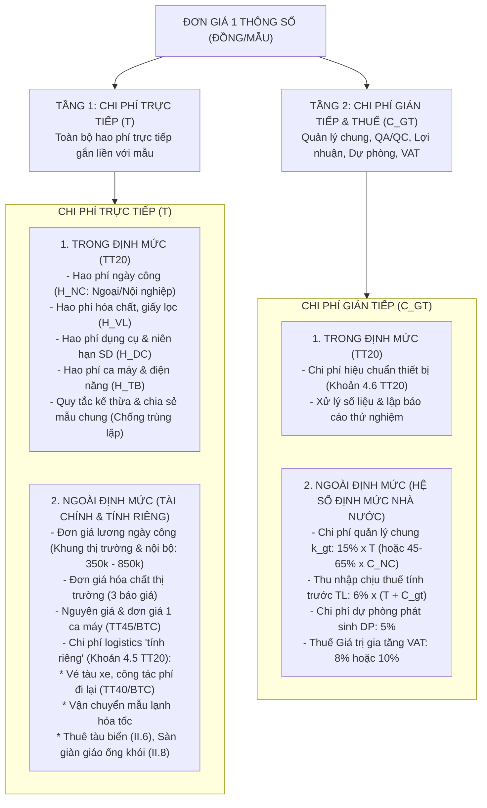

# 📋 BẢN ĐẶC TẢ NGHIỆP VỤ & PHƯƠNG ÁN XÁC ĐỊNH ĐƠN GIÁ
## QUAN TRẮC MÔI TRƯỜNG ĐƠN VỊ TÍNH (ĐỒNG / MẪU)
**Căn cứ pháp lý & Kỹ thuật:**  
- Thông tư số 20/2017/TT-BTNMT ngày 08/8/2017 của Bộ Tài nguyên và Môi trường.
- Nghị quyết số 66.19/2026/NQ-CP ngày 18/5/2026 của Chính phủ.

---

## 📌 I. KẾT LUẬN TỔNG QUAN (EXECUTIVE SUMMARY)

1. **Cấu trúc 2 Tầng vĩ mô của Đơn giá quan trắc môi trường (Đồng/mẫu):**  
   Mọi đơn giá thông số quan trắc đều được cấu thành từ 2 tầng chi phí gốc rễ, trong đó mỗi tầng được phân định rạch ròi giữa **Nhóm yếu tố TRONG ĐỊNH MỨC (Kỹ thuật TT20)** và **Nhóm yếu tố NGOÀI ĐỊNH MỨC (Tài chính, Chế độ Nhà nước, Quy định nội bộ và Chi phí tính riêng)**:

$$\mathbf{P_{\text{(Đồng/mẫu)}}} = \underbrace{\mathbf{T_{\text{Trực tiếp}}}}_{\substack{\text{Nhân công, Hóa chất,} \\ \text{Dụng cụ, Thiết bị, Logistics}}} + \underbrace{\mathbf{C_{\text{Gián tiếp}}}}_{\substack{\text{Chi phí chung, Thu nhập tính trước,} \\ \text{Dự phòng, Thuế VAT}}}$$

2. **Bản chất của đơn vị tính "Đồng / Mẫu" (VNĐ/sample):**
   - **"Mẫu" (Sample) trong quy chuẩn TT20:** Là **01 đơn vị mẫu đại diện vật lý** (1 can nước, 1 bình khí, 1 phin lọc bụi, 1 khối trầm tích) hoặc **01 lần đo/phép thử trực tiếp tại hiện trường** (In-situ test) được thực hiện theo đúng tiêu chuẩn kỹ thuật quy định.
   - **Đơn vị tính "Đồng/mẫu":** Là toàn bộ chi phí tài chính hợp lý, hợp lệ cần thiết để hoàn thành **chu trình trọn gói cho mẫu đó**: từ chuẩn bị vật tư, lấy mẫu hiện trường, bảo quản, vận chuyển, phân tích tại phòng lab đến khi ban hành Phiếu kết quả thử nghiệm đạt chuẩn QA/QC.

---

## 🏛️ II. SƠ ĐỒ PHÂN TẦNG VĨ MÔ: CHI PHÍ TRỰC TIẾP & CHI PHÍ GIÁN TIẾP

---

## 🔍 III. CHI TIẾT TẦNG 1: NHÓM YẾU TỐ QUYẾT ĐỊNH CHI PHÍ TRỰC TIẾP ($T$)

Chi phí trực tiếp cho 1 mẫu bao gồm:
$$\mathbf{T} = \mathbf{C_{NC}} + \mathbf{C_{VL}} + \mathbf{C_{DC}} + \mathbf{C_{TB}} + \mathbf{C_{\text{ngoài ĐM (tính riêng)}}}$$

---

### 1. Phân hệ TRONG ĐỊNH MỨC (Inside Norm - Thông tư 20/2017/TT-BTNMT)
Quy định lượng hao phí định mức kỹ thuật bất biến của Nhà nước cho 01 đơn vị mẫu sản phẩm:

#### A. Chi phí Nhân công ($C_{NC}$):
Công thức xác định:
$$\mathbf{C_{NC}} = \left[ \frac{H_{NC\_field} \times (1 + k_{\text{thời tiết}})}{M_{\text{dùng chung}}} \times L_{\text{bậc\_ngoại}} \right] + \Big[ H_{NC\_lab} \times L_{\text{bậc\_nội}} \Big]$$

*Các biến số và căn cứ pháp lý:*
- **$H_{NC\_field}, H_{NC\_lab}$**: Định mức ngày công lao động công nghệ quy định trong bảng *Hao_Phi_Nhan_Cong* của TT20 (1 ngày công = 08 giờ làm việc theo Khoản 4.1.3 TT20).
- **$k_{\text{thời tiết}} = 0,2$**: Hệ số tính thêm **$+20\%$ công ngoại nghiệp** do thời tiết phải ngừng nghỉ việc quy định bắt buộc tại **Khoản 4.1.3 TT20**.
- **$M_{\text{dùng chung}}$**: Số lượng thông số phân tích dùng chung 1 mẫu hiện trường theo nguyên tắc kỹ thuật chống trùng lặp khối lượng và định mức ($M \ge 1$). Nếu chỉ tiêu lấy mẫu riêng độc lập thì $M_{\text{dùng chung}} = 1$.
- **$L_{\text{bậc}}$**: Đơn giá tiền lương ngày công theo ngạch bậc định biên (Quy chuẩn chức danh theo TTLT 56/2015/TTLT-BTNMT-BNV và mức lương tham chiếu theo khung chi phí nhân công: Hạng II = 850k; Hạng III.1 = 650k; Hạng III.2 = 550k; Hạng IV = 450k; Phổ thông = 350k).
- **Phân hệ công đoạn kỹ thuật:**
  - *Đo nhanh tại chỗ (Single/In-situ):* Chỉ có 1 mã duy nhất, $H_{NC\_lab} = 0$ (ví dụ `KKC2a` đo ồn, `1KT9c` đo NO, `1KT9d` đo $NO_2$).
  - *Ghép cặp chuẩn (Paired: `1...` + `2...`):* 1 công đoạn ngoại nghiệp + 1 công đoạn nội nghiệp.
  - *Phân hệ 3 Tiền tố Nước biển (Học phần II.6):* Phân hóa điều kiện lấy mẫu: **`1NB` (Ven bờ)** vs **`2NB` (Xa bờ - đi tàu biển lớn, số công cao hơn 20-50%)** ghép cặp với **`3NB` (Nội nghiệp phòng lab)**.

#### B. Chi phí Vật liệu, Hóa chất ($C_{VL}$):
Công thức xác định:
$$\mathbf{C_{VL}} = (1 + k_{\text{hao hụt}}) \times \sum_{j=1}^{n} \Big( q_{VL\_j} \times G_{VL\_j} \Big) = \mathbf{1,08} \times \sum_{j=1}^{n} \Big( q_{VL\_j} \times G_{VL\_j} \Big)$$

*Các biến số và căn cứ pháp lý:*
- **$q_{VL\_j}$**: Định mức tiêu hao của loại vật liệu, hóa chất chính thứ $j$ quy định trong bảng *Hao_Phi_Vat_Lieu* của TT20 (lít, ml, gram, kg, cái, hộp...).
- **$k_{\text{hao hụt}} = 0,08$**: Tỷ lệ tính thêm **$+8\%$ vật liệu phụ, vụn vặt và hao hụt** quy định bắt buộc tại **Khoản 4.4 TT20**.
- **$G_{VL\_j}$**: Đơn giá mua sắm hóa chất, vật tư thí nghiệm (theo hóa đơn chứng từ hoặc tối thiểu 3 bảng báo giá cạnh tranh).

#### C. Chi phí Dụng cụ & Bảo hộ lao động ($C_{DC}$):
Công thức xác định:
$$\mathbf{C_{DC}} = (1 + k_{\text{dc\_phụ}}) \times \sum_{m=1}^{p} \left( \frac{q_{DC\_m} \times G_{DC\_m}}{T_m \times 22} \right) = \mathbf{1,10} \times \sum_{m=1}^{p} \left( \frac{q_{DC\_m} \times G_{DC\_m}}{T_m \times 22} \right)$$

*Các biến số và căn cứ pháp lý:*
- **$q_{DC\_m}$**: Định mức số lượng dụng cụ chính thứ $m$ trong bảng *Hao_Phi_Dung_Cu* của TT20.
- **$k_{\text{dc\_phụ}} = 0,10$**: Tỷ lệ tính thêm **$+10\%$ dụng cụ nhỏ, phụ** quy định bắt buộc tại **Khoản 4.2 TT20**.
- **$T_m$**: Thời hạn niên hạn sử dụng (tính bằng tháng) quy định tại Khoản 4.2 TT20; quy đổi chuẩn 22 ca làm việc/tháng $\to$ Tổng số ca trong niên hạn $= T_m \times 22 \text{ ca}$.
- **$G_{DC\_m}$**: Nguyên giá mua sắm dụng cụ, trang bị BHLĐ.

#### D. Chi phí Thiết bị máy móc & Năng lượng ($C_{TB}$):
Công thức xác định:
$$\mathbf{C_{TB}} = \sum_{k=1}^{r} \Big( t_{TB\_k} \times G_{\text{ca\_}k} \Big) + \sum_{k=1}^{r} \Big( P_k \times (t_{TB\_k} \times 8) \times G_{\text{điện}} \Big)$$

*Các biến số và căn cứ pháp lý:*
- **$t_{TB\_k}$**: Định mức ca máy trên 1 mẫu trong bảng *Hao_Phi_Thiet_Bi* của TT20 (1 ca = 8 giờ). Nếu thông số phụ có ghi chú *"Kế thừa từ mục XYZ"* thì $t_{TB\_k} = 0$.
- **$G_{\text{ca\_}k}$**: Đơn giá 1 ca máy trích khấu hao:
  $$G_{\text{ca\_}k} = \frac{\text{Nguyên giá} \times k_{\text{khấu hao năm}} + \text{Chi phí bảo dưỡng, kiểm định/năm}}{N_{\text{ca chuẩn}}}$$
- **$N_{\text{ca chuẩn}}$ xác định theo Khoản 4.3 TT20:**
  - $N_{\text{ca chuẩn}} = \mathbf{250 \text{ ca/năm}}$ đối với máy ngoại nghiệp thông thường.
  - $N_{\text{ca chuẩn}} = \mathbf{200 \text{ ca/năm}}$ đối với thiết bị đo trên biển (Học phần II.6 Nước biển).
  - $N_{\text{ca chuẩn}} = \mathbf{500 \text{ ca/năm}}$ đối với máy phân tích nội nghiệp trong phòng lab.
- **$P_k$**: Công suất tiêu thụ của thiết bị (kW) quy định tại bảng *Hao_Phi_Thiet_Bi* làm căn cứ tính điện năng theo Khoản 4.3 TT20; $G_{\text{điện}}$: Biểu giá điện sản xuất của EVN.

---

### 2. Phân hệ NGOÀI ĐỊNH MỨC (Outside Norm - Chi phí "Tính riêng" theo Khoản 4.5 TT20)
"Ngoài định mức" có nghĩa là **các chi phí không thuộc định mức của Thông tư 20 quy định**, do đó bắt buộc phải lập dự toán riêng theo từng Thiết kế kỹ thuật - Dự toán cụ thể (Khoản 4.5 TT20). Nhóm này được phân định rạch ròi thành 2 tiểu nhóm pháp lý:

#### A. Tiểu nhóm Có định mức chuyên ngành khác quy định:
1. **Chi phí đi lại & lưu trú nhân lực (Logistics con người):**
   - Áp dụng định mức chế độ công tác phí tại **Thông tư số 40/2017/TT-BTC** ngày 28/4/2017 của Bộ Tài chính và Quy chế quản lý nội bộ của EVN.
   - Bao gồm: Tiền vé máy bay/tàu xe đưa đón từ trụ sở đơn vị quan trắc đến hiện trường Vĩnh Tân, phụ cấp lưu trú theo số ngày thực tế trong PAKT.
2. **Chi phí sàn thao tác & lỗ lấy mẫu khí thải ống khói (Học phần II.8):**
   - Áp dụng **Định mức dự toán xây dựng công trình của Bộ Xây dựng** (Thông tư 12/2021/TT-BXD).
   - Bao gồm: Chi phí dựng giàn giáo trèo cao 30m - 100m, gia công mặt bích lỗ lấy mẫu đường kính 4 inch theo chuẩn US-EPA Method 1, kéo nguồn điện tạm 220V/380V.

#### B. Tiểu nhóm KHÔNG CÓ ĐỊNH MỨC NÀO QUY ĐỊNH (Chi phí theo giá thị trường):
Là các chi phí đặc thù không có bất kỳ văn bản định mức kinh tế - kỹ thuật nhà nước nào ban hành mức hao phí, bắt buộc phải thẩm định và xác định theo **3 bảng báo giá cạnh tranh** hoặc hợp đồng dịch vụ:
1. **Chi phí thuê phương tiện thủy chuyên dụng biển (Học phần II.6):**
   - Thuê tàu biển công suất lớn (có đăng kiểm hàng hải, trang bị hải đồ GPS) phục vụ khảo sát nước biển xa bờ, bãi nhận chìm tro xỉ/bùn ngoài khơi Vĩnh Tân.
   - Thuê ca-nô chuyên dụng lấy mẫu nước biển ven bờ và kênh xả nước làm mát.
2. **Chi phí vận chuyển mẫu lạnh hỏa tốc bằng đường hàng không/xe lạnh:**
   - Cước dịch vụ logistics chuyển phát nhanh bảo quản nhiệt độ $2^\circ\text{C} - 6^\circ\text{C}$ bằng thùng xốp đá gel/đá khô từ hiện trường Vĩnh Tân về phòng lab trong vòng 24 giờ.

---

## 📊 IV. CHI TIẾT TẦNG 2: NHÓM YẾU TỐ QUYẾT ĐỊNH CHI PHÍ GIÁN TIẾP ($C_{GT}$) & THUẾ

### 1. Phân hệ TRONG ĐỊNH MỨC (Inside Norm - Thông tư 20/2017/TT-BTNMT)
- **Chi phí hiệu chuẩn thiết bị (Calibration):** Khoản 4.6 TT20 quy định dứt khoát *"Hiệu chuẩn thiết bị được tính toán chung trong chi phí quản lý chung cấu thành trong Đơn giá"*, nghiêm cấm nhà thầu lập riêng thành mục chi phí con!
- **Hao phí tổng hợp và xử lý số liệu:** Công tác đối chiếu quy chuẩn QCVN, vẽ biểu đồ và lập Báo cáo thử nghiệm đạt chuẩn ISO/IEC 17025 (Vimcerts) đã được tích hợp trong tỷ lệ chi phí chung.

### 2. Phân hệ NGOÀI ĐỊNH MỨC (Outside Norm - Định mức tỷ lệ Nhà nước & EVN)
1. **Chi phí Quản lý chung ($k_{GT}$):**  
   Thường áp dụng **$k_{GT} = 15\%$ tính trên Chi phí trực tiếp ($T$)** (hoặc $45\% - 65\%$ tính trên Chi phí nhân công $C_{NC}$), chi trả cho bộ máy điều hành, văn phòng, an toàn vệ sinh lao động.
2. **Thu nhập chịu thuế tính trước ($TL$):**  
   Lợi nhuận định mức cho đơn vị thực hiện quan trắc: **$TL = 6\% \times (T + C_{GT})$**.
3. **Chi phí Dự phòng phát sinh ($DP$):**  
   Dự phòng yếu tố trượt giá và khối lượng phát sinh đột xuất: **$DP = 5\% \times (T + C_{GT} + TL)$**.
4. **Thuế Giá trị gia tăng (VAT):**  
   Áp dụng thuế suất thuế GTGT theo luật định (hiện hành là 8% hoặc 10%).

---

## 📐 V. BẢN ĐỒ CÔNG THỨC TOÁN HỌC XÁC ĐỊNH ĐƠN GIÁ (ĐỒNG/MẪU)

$$\mathbf{P_{\text{(Đồng/mẫu)}}} = \underbrace{\Bigg[ \left( \frac{H_{NC\_field} \times L_{\text{bậc}}}{M_{\text{dùng chung}}} + H_{NC\_lab} \times L_{\text{bậc}} \right) + C_{VL} + C_{DC} + C_{TB} + C_{\text{tính riêng}} \Bigg]}_{\mathbf{\text{TỔNG CHI PHÍ TRỰC TIẾP } (T)}} \times \mathbf{\Phi_{\text{gián tiếp & thuế}}}$$

Trong đó, hệ số tích hợp gián tiếp và thuế:
$$\mathbf{\Phi_{\text{gián tiếp & thuế}}} = (1 + k_{GT}) \times (1 + TL) \times (1 + DP) \times (1 + \text{VAT})$$

- Với $k_{GT} = 15\%$, $TL = 6\%$, $DP = 5\%$, $\text{VAT} = 8\%$:
  $$\mathbf{\Phi_{\text{gián tiếp & thuế}}} = 1,15 \times 1,06 \times 1,05 \times 1,08 \approx \mathbf{1,3823} \quad (+38,23\%)$$

---

## 🛠️ VI. BẢNG MA TRẬN ĐỐI CHIẾU THỰC HÀNH CHO TỔ THẨM ĐỊNH EVN VĨNH TÂN 4

| Nhóm thông số điển hình | Cấu trúc Mã TT20 | Chi phí Trực tiếp Trong ĐM (TT20) | Chi phí Trực tiếp Ngoài ĐM & Tính riêng | Chi phí Gián tiếp & Thuế | Lưu ý cốt tử khi Thẩm định & Chống trùng lặp |
| :--- | :---: | :--- | :--- | :--- | :--- |
| **Bụi TSP ống khói lò hơi VT4** | `1KT10a` + `2KT10a` | - Lấy mẫu Isokinetic: 4,0 công - Cân phân tích lab: 0,8 công - Phin lọc sợi thủy tinh chịu nhiệt | - Lương bậc III.4 (450k) - Giàn giáo sàn thao tác trèo cao 60m (tính riêng) - Khấu hao máy đo lưu lượng | $+38,23\%$ (Chi phí chung + Lợi nhuận + Dự phòng + VAT) | Bắt buộc phải có hạng mục sàn thao tác tính riêng; kiểm tra đúng phương pháp US-EPA Method 5. |
| **Khí NO, NO2 đo trực tiếp ống khói** | `1KT9c`, `1KT9d` | - Đo sensor tại chỗ: 0,75 công/khí - Không có mã nội nghiệp (`2...`) - Không tốn hóa chất | - Lương bậc III.3 (550k) - Khấu hao máy đo khí Flue Gas Analyzer | $+38,23\%$ | **CẤM tính thêm mã nội nghiệp `2KT9b`** vì đã đo trực tiếp bằng sensor; không tính trùng phương pháp. |
| **Khí tổng NOx hóa học ống khói** | `1KT9e` + `2KT9b` | - Hấp thụ Method 7: 0,70 công - So màu lab: 0,80 công - Hóa chất H2SO4, H2O2, PDA | - Lương bậc III.2, III.3 - Khấu hao máy quang phổ UV-VIS | $+38,23\%$ | Chỉ chọn HOẶC đo trực tiếp sensor, HOẶC chọn hóa ướt Method 7, không thanh toán cả hai! |
| **Kim loại nặng nước biển ven bờ (As, Pb, Cd)** | `1NB21` + `3NB21...` | - Lấy mẫu chung: 0,30 công - Phân tích lab AAS/ICP: 0,7-1,0 công - Hóa chất HNO3 tinh khiết, chuẩn | - Lương bậc III.3 - Thuê ca-nô lấy mẫu ven bờ (tính riêng) - Khí Argon chạy máy ICP | $+38,23\%$ | **Khử trùng lặp:** 1 lần lấy mẫu chia đều cho N kim loại; các kim loại phụ kế thừa thiết bị lấy mẫu. |
| **Nước biển xa bờ bãi xỉ/đổ bùn** | `2NB...` + `3NB...` | - Lấy mẫu xa bờ: 0,35 - 1,0 công - Định mức công cao hơn ven bờ 30% | - Thuê tàu biển chuyên dụng lớn (tính riêng theo ngày tàu) - Bảo quản mẫu đá gel hỏa tốc | $+38,23\%$ | Bắt buộc kiểm tra đăng kiểm tàu biển và nhật ký hành trình lấy mẫu xa bờ. |
